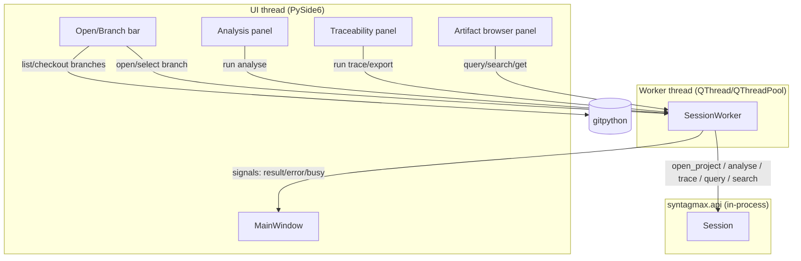

# Full Spec: Native Desktop App for Syntagmax (Reviewer, v1)

**Source seed**: `docs/seed/native-desktop-app.seed.md`
**Source brainstorm**: `docs/brainstorms/native-desktop-app.md`
**Status**: Draft (planned non-interactively by Autoflow, Branch 2)

## Problem Statement

The base Syntagmax tool is a `click` command-line application. Users who are not comfortable on the command line need a self-contained, installable desktop application that lets them **open a project and read its analysis and traceability** without ever touching a terminal. The application must stay entirely within the Python ecosystem (no Electron, no bundled Node runtime), live in its own `syntagmax-desktop` project with the `syntagmax` core as a Git submodule, and be **completely independent** of the `syntagmax-gui` web application (no shared backend, SPA, authentication, or multi-user machinery).

Version 1 is deliberately **read-only** with **basic Git branch selection** as the only Git capability.

## Requirements

Acceptance criteria. Each is phrased so it can be verified by a test or a manual demo.

### Functional

- **R1 — Launch.** The app launches as a desktop window via `uv run syntagmax-desktop` (and via a frozen executable) with no terminal interaction required and no console window on Windows.
- **R2 — Open project.** The user can pick a project's `.syntagmax/config.toml` (or a folder containing it) through a native file/folder dialog; the app calls `syntagmax.api.open_project(..., options=Options(allow_dirty_worktree=True))` and holds the resulting `Session`. **`allow_dirty_worktree=True` is the default for reviewer sessions** (critique P1/X2): a read-only viewer must open ordinary working copies that contain untracked notes, editor swap files, or local edits — the core's `allow_dirty_worktree=False` default would otherwise raise `FatalError`. When a **folder** is picked, resolution checks `<folder>/.syntagmax/config.toml` first, then `<folder>/config.toml`; `Config` requires the exact path to the TOML file, so the resolved path is passed to `open_project`.
- **R2a — Reload project.** The user can trigger a reload (`F5` or a menu action) that refreshes the current project from disk by instantiating a fresh `Session` (or calling `Session.reload()`), so changes authored externally are reflected without re-navigating the file dialog (critique P4).
- **R3 — Open errors are non-fatal.** A `FatalError`/`RMSException`/parse error during open is caught and shown in a dismissible error dialog; the app stays running and returns to the empty state. (The pinned factoid rule — a *global config* parse error is fatal — does not apply here; project-config open failures must not crash the GUI.)
- **R4 — Branch selection.** When the opened project is inside a Git working tree, the app lists local branches (via `gitpython`), lets the user check one out, and **re-opens** the project (new `Session`) on the selected branch. If the project is not a Git repo, the branch control is hidden/disabled, not an error. **Non-destructive, guarded checkout** (critique E1/X1): checkout is **refused with a non-fatal message** when the working tree has uncommitted modifications or conflicting untracked files; a **detached HEAD** (or tag/rebase state) is displayed as `(HEAD detached at <short-sha>)` with switching disabled rather than crashing (`repo.active_branch` raises `TypeError` when detached); `GitCommandError` and Windows file-lock/permission failures (e.g. a stale `.git/index.lock`) are caught and surfaced, never leaving the tree in an inconsistent state.
- **R5 — Analysis panel.** The user can run analysis (`Session.analyse()`); the result renders as (a) a **metrics** strip and (b) a **diagnostics** list grouped by `location`, each row showing `severity`, `rule`, `category`, `message`, and `artifact_id`. **Severity filter toggles** (`Error`/`Warning`/`Info`) sit above the grouped list so blocking issues are not buried among informational notices (critique P3). Rendering is defensive against empty/unknown metric shapes and an empty diagnostics list (positive "no issues" confirmation).
- **R6 — Traceability panel.** The user can select a child `atype`, a parent `atype`, a **direction (`forward` or `reverse`)**, and an **independent `flat` toggle** — these are orthogonal, matching `Session.trace(child_type, parent_type, *, direction=..., flat=...)`; `flat` is **not** a direction value (critique E2/X3). The result renders as a dense table backed by a `QAbstractTableModel` (not an item-based `QTableWidget`) so large matrices do not freeze the UI (critique E6). The user can **export** the matrix to a `.csv` or `.tsv` file on disk via `syntagmax.api.render_trace(result, delimiter=...)`; CSV is written with **`encoding='utf-8-sig'`** (BOM) for Microsoft Excel compatibility, and a locked/unwritable target (e.g. the file is open in Excel → `PermissionError`) is caught and surfaced as a non-fatal dialog (critique E7).
- **R7 — atype discovery.** The child/parent selectors are populated from the project's declared artifact types: read `config.metamodel['artifacts']` (a dict keyed by artifact-type name) when present, else fall back to the distinct `atype` values from `Session.query()` (mirroring the GUI gateway's `list_atypes`). Because `Session` exposes `_config` as a private attribute with no public `metamodel` accessor, this access is **encapsulated inside `core_facade.py`** with the `Session.query()` fallback, so the UI never reaches into core internals and the app degrades gracefully if the core is refactored upstream (critique E2 encapsulation note).
- **R8 — Read-only artifact browser.** The user can browse artifacts grouped by `atype` (`Session.query()`), filter by type, search by content (`Session.search(q)`, case-insensitive AND semantics), select one, and view its `fields`, parent/child links, and rendered Markdown `body`. **Parent/child identifiers are clickable** and select the target artifact in the browser, so a reviewer auditing traceability can follow a dangling or invalid link directly instead of copy-pasting ids (critique P2). The search input is **debounced (~250–300 ms via `QTimer`)** so a full linear `Session.search` scan does not fire on every keystroke (critique E5). The Markdown view sets `document().setBaseUrl(...)` to the project root so relative image references resolve; `QTextBrowser.setMarkdown()`'s CommonMark-subset limitations (no GFM tables, no Obsidian wikilinks) are a documented v1 constraint (critique E8). No create/edit/delete controls exist anywhere in v1.
- **R9 — Responsiveness.** Every core call (`open_project`, `analyse`, `trace`, `query`, `search`) runs **off the UI thread**; the window never freezes during a long operation and shows a busy indicator plus a failure path (error surfaced, UI recovered). Because the single worker **serialises** requests, a long `analyse()`/`trace()` must **busy-mask** the UI so later search/filter requests are not silently queued behind it (critique E5 architecture note); dense views use virtual Qt models (`QAbstractTableModel`/`QAbstractListModel`), not item widgets, to stay responsive on large datasets (critique E6).
- **R9a — Crash telemetry.** A top-level `sys.excepthook` writes uncaught exceptions to an application log (`%LOCALAPPDATA%/Syntagmax/logs/crash.log` on Windows; the platform-appropriate user data dir elsewhere) before the process exits, because the frozen Win32 GUI build (`base="gui"`) detaches stdout/stderr and would otherwise terminate silently (critique E4).

### Non-functional

- **R10 — Pythonic stack.** UI is **PySide6** (Qt for Python). No Node/Electron/bundled-Chromium runtime.
- **R11 — Independence.** No import of, or runtime dependency on, `syntagmax-gui`.
- **R12 — Submodule revision.** The `syntagmax` submodule is advanced to the **exact commit the `syntagmax-gui` submodule points to**, verified as **`cca2a29`** (`feat(api): expose Session.trace and Session.publish facade methods`, described `2026.09.16-22-gcca2a29`) on branch **`more-gui-adaptations`** — **not** upstream `main` (critique E9). The spec records this because the API-bearing commit does not yet exist on `main`; the submodule tracks `more-gui-adaptations` until that branch merges upstream. Wired as an editable `uv` source. Its `syntagmax.api` exposes `open_project`, `Session.analyse`, `Session.trace`, and `render_trace`.
- **R13 — Packaging.** A Windows installer (MSI or equivalent) is produced via **cx_Freeze**, reusing the core's package list as a starting point; the frozen build launches and opens a project on a clean Windows environment.
- **R14 — Portability-ready.** No Windows-only API is used in application code; the same PySide6 code is expected to run on macOS/Linux without modification (packaging for those is out of scope but must not be precluded).
- **R15 — Licensing.** PySide6's LGPL licensing is confirmed compatible with the core's MIT licence, and the decision is recorded in the docs.
- **R16 — Documentation.** `README.md` **and** `docs/reference/` pages document install, launch, and the reviewer workflow (per the project rule that every spec includes a documentation task covering README and `docs/reference/`).
- **R17 — Tests.** Headless pytest coverage exists for the non-UI logic (session worker, branch listing, atype discovery, trace export) and for cross-thread signal interactions using **`pytest-qt` (`qtbot.waitSignal`)** with Qt's offscreen platform (`QT_QPA_PLATFORM=offscreen`). `pytest-qt` is required because asserting on queued cross-thread Qt signals without an active event loop deadlocks or races (critique E3). A **sanity test asserts `syntagmax.api.open_project` is importable**, so the submodule can never silently regress to a pre-API core commit (critique E9).

## Background (codebase internals the implementer needs)

### The embedding API (`syntagmax.api`) — authoritative surface

Verified from the pin-target `api.py`. The host must use these exact signatures:

- `open_project(config_path: str | Path, *, options: Options | None = None) -> Session` — `FatalError`/`RMSException` propagate; the facade never swallows them.
- `Options(render_tree=False, no_git=False, allow_dirty_worktree=False, suppress_tracing=False, tasks=False, language='en', warnings_as_errors=False, log_level=None)`.
- `Session.analyse() -> AnalysisResult` where `AnalysisResult(diagnostics: list[Diagnostic], metrics, impact)`.
- `Diagnostic(severity, artifact_id, rule, category, location, message)`.
- `Session.trace(child_type, parent_type, *, direction='forward', attributes=None, flat=False) -> TraceResult` where `TraceResult(direction, child_type, parent_type, header: list[str], rows: list[list[str]], record_names: dict[str,str])`.
- `render_trace(result: TraceResult, *, delimiter: str = ',') -> str` — module-level function; use `delimiter='\t'` for TSV.
- `Session.query(*, atype: str | None = None) -> list[ArtifactView]` (excludes the synthetic `ROOT`).
- `Session.search(q: str) -> list[ArtifactView]` (case-insensitive, AND semantics, searches aid/atype/fields incl. body).
- `Session.get(aid) -> ArtifactView | None`.
- `ArtifactView(aid, atype, fields: dict[str, str|list[str]], parents: list[dict], children: list[str], latest_revision, body: str | None)`.
- `Session` is thread-safe (internal lock); `reload()` clears the cache. v1 never calls the write methods (`edit`/`create`/`delete`) or `capabilities`.

### Proven consumption pattern (from `syntagmax-gui/src/syntagmax_gui/core_gateway.py`)

- Open: `api.open_project(config_path, options=api.Options(no_git=no_git))`.
- atypes: read `config.metamodel['artifacts']` and `sorted({str(a) for a in artifacts})`; fallback `sorted({v.atype for v in session.query()})`.
- Analysis: `result = session.analyse()` → render `result.metrics` + `result.diagnostics`.
- Trace: `result = session.trace(child, parent, direction=direction, flat=flat)` → `render_trace(result, delimiter=...)`.
- Note: the gateway holds a `_workspace_lock` and reuses a `Session`; the desktop app is single-user and can hold one `Session` per open project guarded by its worker.

### The core CLI (for reference only — v1 does NOT shell out)

`syntagmax/src/syntagmax/cli.py` exposes the `rms` group. The desktop app consumes the library directly; the CLI is relevant only as a behavioural reference for what `analyse`/`trace` produce.

### Packaging precedent

`syntagmax/pyproject.toml` already configures `[tool.cxfreeze]` with a Windows `bdist_msi` target and a `build_exe` package list (`syntagmax`, `polars`, `lark`, `jinja2`, `babel`, `git`, `pydantic`, `benedict`, `yaml`, `rich`, `ruamel`, `uvicorn`, `mcp`, `click`). The desktop MSI reuses this list and adds `PySide6` and `shiboken6`, with `base = "gui"` (Win32GUI) so no console window appears.

## Proposed Solution

### Architecture



- **One `Session` per open project**, owned by `SessionWorker` and only touched on the worker thread. The UI thread never calls `syntagmax.api` directly; it emits requests and receives Qt signals (`resultReady`, `failed`, `busyChanged`).
- **Branch selection** uses `gitpython` to enumerate `repo.heads`, check out the chosen branch, and trigger a project re-open (fresh `Session`). Guard: refuse/branch-disable on a dirty or detached state with a clear message rather than a crash.
- **Panels** are plain `QWidget`s driven by signals; no business logic in widgets beyond formatting.

### Package layout

```
src/syntagmax_desktop/
    __init__.py
    __main__.py            # enables `python -m syntagmax_desktop`
    app.py                 # QApplication bootstrap + MainWindow wiring; entry point `main()`
    session_worker.py      # SessionWorker: owns Session, runs core calls off-thread, emits signals
    core_facade.py         # thin, UI-agnostic wrappers over syntagmax.api (open, analyse, trace, export, atypes, query, search)
    git_branches.py        # list_branches / current_branch / checkout via gitpython; non-repo + dirty handling
    views/
        __init__.py
        main_window.py     # QMainWindow: toolbar (open, branch combo), tab stack
        analysis_panel.py  # metrics strip + grouped diagnostics
        trace_panel.py     # child/parent/direction selectors, table, export
        browser_panel.py   # atype-grouped list, type filter, search box, detail view (fields + Markdown body)
    widgets/
        __init__.py
        markdown_view.py   # renders ArtifactView.body as Markdown (QTextBrowser.setMarkdown)
tests/
    test_core_facade.py    # against a fixture project (reuse syntagmax/example/*)
    test_git_branches.py   # temp git repo fixtures
    test_trace_export.py   # render_trace CSV/TSV delimiter correctness
    test_session_worker.py # offscreen Qt: request -> signal round trip
pyproject.toml             # PySide6 + editable syntagmax source; [project.scripts]; [tool.cxfreeze]
```

### Key data mappings

- **Diagnostics grouping**: group `result.diagnostics` by `Diagnostic.location`; a blank/missing location falls into an explicit "Unspecified location" group (mirrors the GUI's Analysis panel behaviour).
- **Metrics**: `AnalysisResult.metrics` is a `benedict`-or-`None`; render as labelled stat cards, tolerating missing keys. Do not assume a fixed schema.
- **Trace table**: `TraceResult.header` are the column labels; `TraceResult.rows` are already header-ordered — render verbatim. Export calls `render_trace(result, delimiter=',' | '\t')` and writes the returned string to the chosen path.
- **Browser detail**: show `ArtifactView.fields` as a key/value table, `parents`/`children` as **clickable** id links that select the target artifact (critique P2), and `body` via `QTextBrowser.setMarkdown` with `document().setBaseUrl(project_root)` for relative images (critique E8).

## Task Breakdown

> Each task is independently implementable and testable. Dependencies are noted. `[ ]` = incomplete.

### [ ] Task 1 — Project foundation & submodule advance
- **Objective**: Make `syntagmax-desktop` a runnable PySide6 app skeleton on the correct core revision.
- **Guidance**: Advance the `syntagmax` submodule to the exact commit `syntagmax-gui` points to — **`cca2a29` on branch `more-gui-adaptations`** (verify `syntagmax.api.open_project` imports). Set `pyproject.toml`: `dependencies = ["PySide6", "gitpython", "syntagmax"]`, `[tool.uv.sources] syntagmax = { path = "syntagmax", editable = true }`, `[project.scripts] syntagmax-desktop = "syntagmax_desktop.app:main"`, hatchling wheel target `src/syntagmax_desktop`, pytest config (`pythonpath=["src"]`), ruff, and dev deps `pytest`, `pytest-qt`, `cx-freeze`. Create `app.py` with a `main()` that shows an empty `MainWindow` and installs the `sys.excepthook` crash logger (R9a).
- **Tests/Demo**: `uv sync` succeeds; a **sanity test** asserts `from syntagmax.api import open_project` imports (R12/E9 regression guard); `uv run syntagmax-desktop` opens a window (manual, or offscreen smoke test asserting `MainWindow` constructs).
- **Depends on**: none.

### [ ] Task 2 — Core facade (UI-agnostic)
- **Objective**: `core_facade.py` wrapping `syntagmax.api` for open, analyse, trace, export, atype discovery, query, search.
- **Guidance**: `open(config_path) -> Session` via `open_project(..., options=Options(allow_dirty_worktree=True))` (P1/X2) with folder→`config.toml` resolution (R2); `analyse(session)`, `trace(session, child, parent, direction, flat)`, `export_trace(result, path, delimiter)` using `render_trace` and writing CSV as `utf-8-sig` (E7), `atypes(session)` encapsulating the `config.metamodel['artifacts']`-then-`query()` fallback so the UI never touches `session._config` (E2), `query`/`search` passthroughs. Let core exceptions propagate; the worker translates them.
- **Tests/Demo**: `test_core_facade.py` against a fixture project copied from `syntagmax/example/` — assert analyse returns an `AnalysisResult`, trace returns expected header/rows, atypes non-empty.
- **Depends on**: Task 1.

### [ ] Task 3 — Git branch logic
- **Objective**: `git_branches.py` — list local branches, current branch, checkout; graceful non-repo and dirty handling.
- **Guidance**: Use `gitpython` (`Repo(path, search_parent_directories=True)`). `list_branches` returns `[]` for a non-repo (caller hides the control). `current_branch` handles **detached HEAD** without raising (guard `repo.head.is_detached` before `repo.active_branch`, report `(HEAD detached at <sha>)`). `checkout(name)` refuses on a dirty tree with a typed error the UI shows as a dialog, and catches `GitCommandError`/Windows permission/lock failures (never leaving a stale `.git/index.lock`) (E1/X1).
- **Tests/Demo**: `test_git_branches.py` with temp repos (init, create branches, assert list/current/checkout; non-repo → `[]`; dirty → refusal; **detached HEAD → labelled, switching disabled**).
- **Depends on**: Task 1.

### [ ] Task 4 — Session worker & threading
- **Objective**: `session_worker.py` running all facade calls off the UI thread with Qt signals.
- **Guidance**: `QObject` moved to a `QThread` (or `QRunnable` on a `QThreadPool`). Slots: `openProject`, `runAnalyse`, `runTrace`, `exportTrace`, `runQuery`, `runSearch`. Signals: `opened(ok)`, `analysisReady(AnalysisResult)`, `traceReady(TraceResult)`, `failed(str)`, `busyChanged(bool)`. Catch `FatalError`/`RMSException`/`Exception`, emit `failed` with a readable message. Because the worker serialises, emit `busyChanged(True/False)` so the UI **busy-masks** rather than queuing orphaned requests behind a long run (E5).
- **Tests/Demo**: `test_session_worker.py` with `pytest-qt` (`qtbot.waitSignal`) and `QT_QPA_PLATFORM=offscreen`: open fixture → `opened(True)`; analyse → `analysisReady`; bad path → `failed` (E3).
- **Depends on**: Tasks 2, 3.

### [ ] Task 5 — Main window, open flow & branch bar
- **Objective**: `main_window.py` — toolbar with Open action (file dialog), branch combo, and a tab stack; wires the worker.
- **Guidance**: Open action → `QFileDialog` for `config.toml` (or folder, resolved per R2) → `worker.openProject`. On `opened`, populate the branch combo (`git_branches.list_branches`) and enable tabs. Branch combo change → guarded checkout + re-open. A **Reload** action (`F5`) re-opens the current project (R2a). A **Recent Projects** list persisted via `QSettings` offers one-click re-open (P4). On `failed`, show `QMessageBox`. Busy indicator in the status bar.
- **Tests/Demo**: offscreen test constructs `MainWindow`, invokes open with a fixture path, asserts tabs enabled and branch combo populated.
- **Depends on**: Task 4.

### [ ] Task 6 — Analysis panel
- **Objective**: `analysis_panel.py` — metrics strip + diagnostics grouped by location.
- **Guidance**: "Run analysis" → `worker.runAnalyse`. Render `metrics` as stat cards (defensive against `None`/unknown shape); diagnostics in a `QTreeWidget`/`QTableView` grouped by `location` ("Unspecified location" fallback), columns severity/rule/category/message/artifact_id, with **severity filter toggles** (Error/Warning/Info) above the list (P3). Empty diagnostics → positive confirmation.
- **Tests/Demo**: unit-test a pure `group_diagnostics(diagnostics)` helper (grouping + fallback); manual run shows the fixture project's diagnostics.
- **Depends on**: Task 5.

### [ ] Task 7 — Traceability panel
- **Objective**: `trace_panel.py` — child/parent `atype` selectors, a direction selector (`forward`/`reverse`), an independent `flat` checkbox, matrix table, CSV/TSV export.
- **Guidance**: Populate selectors from `core_facade.atypes`. "Run" → `worker.runTrace(child, parent, direction, flat)` — direction and `flat` are **orthogonal** (E2). Render `header`+`rows` in a `QTableView` backed by a `QAbstractTableModel` (E6). "Export" → `QFileDialog` (`.csv`/`.tsv`) → `worker.exportTrace` with the matching delimiter; CSV uses `utf-8-sig`; a `PermissionError` (locked file) surfaces a dialog (E7).
- **Tests/Demo**: `test_trace_export.py` asserts CSV vs TSV delimiter output **and `utf-8-sig` BOM for CSV**; manual run renders and exports a matrix for the fixture.
- **Depends on**: Tasks 5, 2.

### [ ] Task 8 — Read-only artifact browser
- **Objective**: `browser_panel.py` + `markdown_view.py` — atype-grouped list, type filter, content search, detail view.
- **Guidance**: List from `query()`, grouped by `atype` (virtual model, E6); type filter combo; search box → `search(q)` **debounced ~250 ms via `QTimer`** (E5). Selection → detail: fields key/value table, **clickable** parent/child id links that select the target artifact (P2), `body` via `QTextBrowser.setMarkdown` with `setBaseUrl(project_root)` (E8). No write controls.
- **Tests/Demo**: offscreen test: populate from fixture, filter by an atype, search a known term → expected subset; detail shows body text.
- **Depends on**: Task 5.

### [ ] Task 9 — Windows packaging (cx_Freeze)
- **Objective**: Frozen Windows build + MSI that launches and opens a project.
- **Guidance**: Add `[tool.cxfreeze]` to `pyproject.toml` reusing the core's `build_exe.packages` plus `PySide6`, `shiboken6`; **explicitly include the Qt platform plugin** (`platforms/qwindows.dll`), styles, and SVG libs via `include_files`/package data so the frozen binary runs on a clean system (E4 operational). Executable `script = "src/syntagmax_desktop/app.py"`, `base = "gui"`, `target_name = "syntagmax-desktop"`; `bdist_msi` with `product_name`, a fixed `upgrade_code`, Start-Menu/desktop shortcuts, and **per-user scope (`all_users=False`)** to avoid forced UAC. Confirm `app.py`'s `sys.excepthook` crash logger (R9a) is active in the frozen build. Add `cx-freeze` to the dev group.
- **Tests/Demo**: `uv run python -m cxfreeze build` produces an exe; manual launch on **clean Windows** opens a project (verifies Qt plugins bundled); trigger a forced exception and confirm `crash.log` is written. Document the exact build command.
- **Depends on**: Tasks 5–8.

### [ ] Task 10 — Documentation, licensing note & feedback hooks
- **Objective**: `README.md` + `docs/reference/` pages; record the PySide6-LGPL/MIT compatibility decision.
- **Guidance**: README quickstart (`uv sync`, `uv run syntagmax-desktop`, build MSI). `docs/reference/desktop-app.md` (reviewer workflow, panels, read-only scope, branch selection) and `docs/reference/packaging.md` (cx_Freeze build). Add a short licensing section (R15). Reference paths relative.
- **Tests/Demo**: docs render; links resolve.
- **Depends on**: all prior.

## Assumptions (made non-interactively; recorded per Autoflow)

1. The pin target for the submodule is the exact commit `syntagmax-gui` points to — verified as **`cca2a29` on `more-gui-adaptations`** (not `main`); the submodule tracks that branch until it merges upstream (R12/E9).
2. "Windows installer" means an MSI via cx_Freeze (matching the core); a one-file PyInstaller build is an acceptable alternative only if cx_Freeze + PySide6 proves infeasible — recorded as a risk, not a default.
3. Parent/child links **are clickable** and navigate within the browser (revised from the original draft per critique P2, which showed static labels break the reviewer's traceability workflow).
4. Test fixtures reuse an existing project under `syntagmax/example/` rather than inventing a new corpus, to keep the spec grounded in real core behaviour.
5. A single open project at a time (no multi-window/MDI) is sufficient for v1.

## Out of Scope (v1)

Any `syntagmax-gui` dependency; auth/multi-user/OIDC; artifact editing and the Obsidian write seam; Git commit/push/PR; publication export (`Session.publish`) and impact visualisation; macOS/Linux packaging; mobile; cloud.
