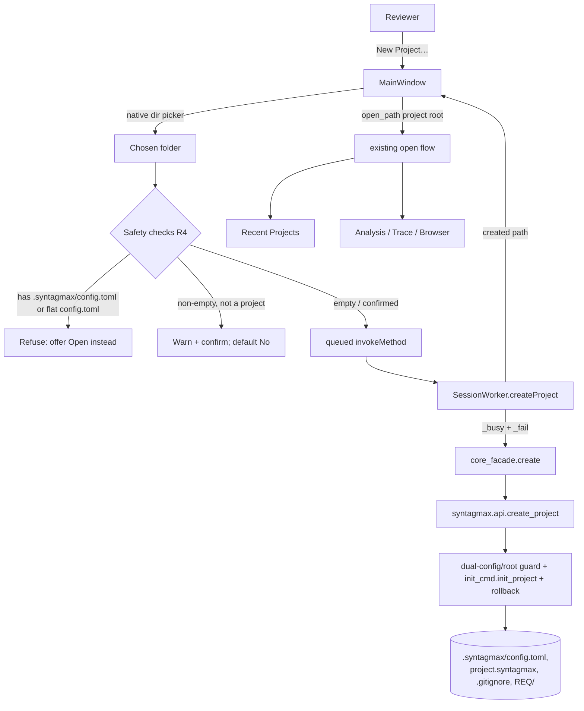

# Full Spec: Create a New Project from the Desktop App

Derived from `docs/seed/new-project.seed.md` (GitHub issue #1, "New Project"). This spec is the implementation blueprint for adding a one-click **New Project** flow to Syntagmax Desktop, backed by a new public project-creation entry point in the Syntagmax core's `syntagmax.api` embedding surface.

## Problem Statement

Today the only way to create a Syntagmax project is the command-line `syntagmax init` command, which scaffolds `.syntagmax/config.toml`, a starter metamodel, and a `.gitignore`. A reviewer who works entirely inside Syntagmax Desktop cannot create a new project without dropping to a terminal — directly contradicting the application's reason for existing. GitHub issue #1 asks, verbatim, "A user-friendly app. How can I create a new project quickly?"

The feature must let a reviewer go from an empty folder to an open, valid, analysable project in a few clicks, producing a scaffold indistinguishable from the CLI's, and it must do so through the public `syntagmax.api` surface rather than reaching into core internals or shelling out to the CLI.

## Scope and Scope-Change Decision

This is the **first write capability** in Syntagmax Desktop. The v1 seed (`docs/seed/native-desktop-app.seed.md`) fixed the application scope as strictly read-only: "No artifact editing, no commit, no push." Creating a project writes files to disk, so this feature is a deliberate, bounded extension of that scope, framed as a post-v1 (v2) addition. The following guardrails are part of the requirement, not incidental:

- The only write introduced is a one-time project **bootstrap** (scaffold). No artifact create, edit, or delete controls are added anywhere.
- After creation the application remains a read-only reviewer, opening the new project through exactly the same path as any opened project.
- The scaffold writes files only. It performs no `git init`, no commit, and no push, consistent with the core's design that Git writes never happen in the core (confirmed against the embedding API: "Git stays in the backend. The core does NOT commit").

## Requirements

Acceptance criteria, referenced by the task breakdown.

### Core (submodule) requirements

- **C1 — Public API entry point.** `syntagmax.api` exposes a new function that scaffolds a project at a caller-chosen directory and returns no artifacts (bootstrap is write-only). It wraps the existing `syntagmax.init_cmd.init_project` so the on-disk result is byte-for-byte identical to `syntagmax init`.
- **C2 — Signature and naming.** The function is `create_project(path: str | Path) -> Path`. It accepts the target project directory (the folder that will contain `.syntagmax/`), creates the scaffold there, and returns the resolved path to the written `config.toml`. The name `create_project` (rather than mirroring the internal `init_project`) is chosen for a host-facing verb; see D1.
- **C3 — Safety: refuse existing project (both config locations).** If the target already contains **either** `.syntagmax/config.toml` **or** a flat `config.toml` at the project root, `create_project` raises a `FatalError` (the core's existing exception type) rather than overwriting or scaffolding a conflicting dual-configuration structure. Both locations are checked because `core_facade.open` accepts either, so a flat-root project must be detected too (critique P7, E2). Scaffolding never clobbers an existing project.
- **C4 — Target directory creation.** If the target directory does not exist, `create_project` creates it (including parents). An existing non-empty, non-project directory is permitted at the core layer; the "warn before scaffolding into a non-empty folder" decision is a UI concern (R4), not a core refusal.
- **C5 — Exception propagation and atomic rollback.** `OSError`/`PermissionError` from the underlying writes propagate unchanged, consistent with the rest of `syntagmax.api` (e.g. `open_project` propagates `FatalError`/`RMSException` without swallowing them). Additionally, scaffolding must not leave a half-written project: if any write fails after `.syntagmax/` is created, `create_project` removes the `.syntagmax/` directory it created before re-raising, so a failed attempt does not leave a broken project that both blocks a retry (C3) and fails to open (critique E1, X1). The rollback only removes scaffold artefacts `create_project` itself created.
- **C6 — Reject filesystem root.** `create_project` refuses to scaffold at a filesystem root (where `target == target.parent`), raising `FatalError`, so an accidental root selection cannot write a `.syntagmax/` into a system root (critique E5).
- **C7 — Default input directory.** `create_project` also creates the default input directory `REQ/` (matching the `[[input]] dir = "REQ"` block that `generate_toml` writes), so the scaffolded structure matches the generated config immediately and the browser is not confronted with a missing input directory (critique P4).
- **C8 — Core test coverage.** A core test scaffolds into a `tmp_path`, asserts the scaffold files (`.syntagmax/config.toml`, `.syntagmax/project.syntagmax`, `.syntagmax/.gitignore`) and the `REQ/` directory exist, asserts the project opens via `open_project` and analyses cleanly, and asserts the refusal path (C3) raises for both an existing `.syntagmax/config.toml` **and** a flat `config.toml`.
- **C9 — Core reference doc.** The core's embedding-API reference documents the new entry point.

### Desktop (host) requirements

- **R1 — Facade seam.** `core_facade` gains a `create(path)` function that calls `syntagmax.api.create_project` and returns the resolved `config.toml` path, so the UI never touches `syntagmax.api` directly (mirrors the existing `core_facade.open`).
- **R2 — Worker slot.** `SessionWorker` gains a `createProject(path)` slot, bracketed by the existing `_busy()` guard and routing every exception through `_fail()` (redacted), consistent with every other worker slot. On success it emits a new `created(str)` signal carrying the resolved `config.toml` path.
- **R3 — New Project command.** The main window adds a "New Project…" action, wired into both the File menu (near Open) and the toolbar. It is always enabled (unlike panel actions, it does not require an open project).
- **R4 — Folder picker and safety checks.** "New Project…" opens a native directory picker (title text explicitly guides the reviewer to choose or create an empty target folder). After a folder is chosen, and before dispatching to the worker, the window:
  - refuses (with a dialog offering to *open* instead) when the folder already contains **either** `.syntagmax/config.toml` **or** a flat `config.toml` (critique P7);
  - warns and requires confirmation when the folder is non-empty but is not a Syntagmax project, with the **`No` button as the explicit default** so an accidental Enter/Space does not scaffold into a populated folder (critique P6);
  - guards the non-empty check against `OSError`/`PermissionError` (e.g. an unreadable folder or a disconnected network share) and surfaces a non-fatal error dialog rather than letting the exception reach the UI event loop (critique E3);
  - proceeds silently for an empty folder or a newly named subfolder.
- **R5 — Auto-open after creation.** On `created`, the window opens the freshly scaffolded project through the existing `open_path` flow, so the reviewer lands in the normal analysis/browse view with no extra interaction.
- **R5a — First-run guidance.** Opening a scaffolded (artifact-count-zero) project shows a lightweight empty-state hint directing the reviewer to add Markdown specification files under `REQ/`. This reuses the existing panels' empty rendering where possible and adds no write capability (critique P1, X2).
- **R5b — Reveal project folder.** The File menu gains a read-only "Reveal Project Folder" action (enabled when a project is open) that opens the project root in the OS file manager via `QDesktopServices.openUrl`, closing the loop between scaffold and external authoring. This is a navigation convenience, not a write (critique P3, X2).
- **R6 — Recent Projects integration (project root, not config path).** The newly created project is recorded in the MRU store via the existing `open_path` → `_remember_recent` path. To keep the MRU consistent with folder-based opens (which store a directory), `_on_created` passes the **project root directory**, not the internal `.syntagmax/config.toml` path, to `open_path`; `core_facade.open` resolves the folder to its config (critique E9).
- **R7 — Off-UI-thread.** The scaffold write runs on the worker thread via a queued `QMetaObject.invokeMethod`, never on the UI thread, consistent with R9 of the v1 spec.
- **R7a — Action lockout during worker runs.** `_on_busy_changed` disables `_new_action`, `_open_action`, and `_reload_action` (and their toolbar buttons) whilst the worker is busy, so a reviewer cannot queue a second New/Open/Reload behind an in-flight creation and desynchronise `_current_path` (critique E4, X3).
- **R8 — Desktop test coverage.** Tests cover the facade seam (scaffold into `tmp_path`, assert the files, the `REQ/` directory, and a clean open), the worker slot (busy bracketing, `created` emission, failure redaction), and the safety checks: the R4 refusal branch (both `.syntagmax/config.toml` **and** flat `config.toml`), the non-empty warning branch, the permission-error guard, and that New/Open/Reload are disabled during a busy run (critique E7). Use the existing Qt test harness and `SettingsStore` injection pattern.
- **R9 — Documentation.** `README.md` and `docs/reference/desktop-app.md` are updated. The README's "Read-only scope" section is amended to acknowledge the single bootstrap write precisely (creation only; review remains read-only). This satisfies the project rule that every spec includes a documentation task covering README **and** `docs/reference/`.

### Cross-cutting

- **R10 — No regression.** The v1 read-only review, traceability, branch-selection, and open flows are unchanged in behaviour.
- **R11 — Submodule branch.** The core change lands on a new branch inside the `syntagmax` submodule, based on the currently pinned known-good revision, so the desktop app can depend on it without disturbing the core's `main`.

## Background

### Core: how `init` works today

`syntagmax/src/syntagmax/init_cmd.py` provides `init_project(cwd: str | None = None) -> None`. It:

1. resolves `base_dir = Path(cwd) if cwd else Path.cwd()`;
2. creates `base_dir / '.syntagmax'` if absent;
3. writes `config.toml` from `generate_toml()` (a commented template derived from the Pydantic `ConfigFile`/`MetricsConfig`/`ImpactConfig`/`AiConfig` models, with a live `[[input]]` block and `[metamodel] filename = "project.syntagmax"`);
4. writes `project.syntagmax` with a minimal `artifact SYS` metamodel;
5. writes `.syntagmax/.gitignore` containing `reports/`.

Crucially `init_project` does **not** guard against an existing project — it overwrites `config.toml` unconditionally. The new `create_project` must add the C3 refusal rather than inherit the overwrite behaviour.

The CLI wires it in `syntagmax/src/syntagmax/cli.py`:

```python
@rms.command(help='Initialize a new Syntagmax project')
@click.pass_context
def init(ctx):
    cwd = ...  # resolved working directory
    init_project(cwd)
```

### Core: the public API surface

`syntagmax/src/syntagmax/api.py` is the "library-first embedding facade". It currently exposes `Options`, `ArtifactView`, `Diagnostic`, `AnalysisResult`, `TraceResult`, `PublishResult`, module-level `open_project(...)` and `render_trace(...)`, and the `Session` class (`artifacts`, `get`, `query`, `search`, `analyse`, `trace`, `publish`, `edit`, `create`, `delete`, `capabilities`, `reload`). It does **not** export `init_cmd.init_project`. `open_project` resolves the config path, builds `Config`, and returns a `Session`; `FatalError`/`RMSException` propagate out of every call. `create_project` will sit alongside `open_project` as a second module-level entry point.

Note the naming overlap: `Session.create(...)` already exists and creates an *artifact*. The new module-level `create_project(...)` creates a *project* — a different noun at a different scope (module-level, not a `Session` method), so there is no collision, but the spec names them explicitly to avoid reader confusion (D1).

### Desktop: the host architecture

- `src/syntagmax_desktop/core_facade.py` — the single seam over `syntagmax.api`. `open(config_path)` resolves a folder to `<folder>/.syntagmax/config.toml` (then `<folder>/config.toml`) and calls `open_project(..., options=Options(allow_dirty_worktree=True))`. The new `create(path)` goes here.
- `src/syntagmax_desktop/session_worker.py` — `SessionWorker(QObject)` on a `QThread`. Signals: `opened(bool)`, `analysisReady`, `traceReady`, `atypesReady`, `queryReady`, `searchReady`, `failed(str)`, `busyChanged(bool)`. Each slot uses the `_busy()` context manager and `_fail(exc)` (secret-redacted). The new `createProject(str)` slot and `created(str)` signal go here.
- `src/syntagmax_desktop/views/main_window.py` — `MainWindow(QMainWindow)`. Builds actions in `_build_actions`, toolbar in `_build_toolbar`, File menu in `_build_menu`. The open flow is `open_project_dialog` → `open_path(path)` → `_dispatch_open` (queued invoke of the worker's `openProject`) → `_on_opened` (which calls `_remember_recent` and refreshes panels). The new action, picker, safety checks, dispatch, and `created` handler go here, reusing `open_path` for R5/R6.
- `src/syntagmax_desktop/settings_store.py` — `SettingsStore` MRU over `QSettings`, injectable for tests via a throwaway `QSettings`.

### Testing conventions

Desktop tests drive the window and worker with a `QApplication` and an injected `SettingsStore(QSettings(...))` scoped to a temporary INI file, and use `tmp_path` for on-disk scaffolds. Core tests (`syntagmax/tests/`) use `pytest` with `tmp_path` fixtures.

## Proposed Solution

### Architecture



### Core: `create_project`

Add to `syntagmax/src/syntagmax/api.py`:

```python
from syntagmax.errors import FatalError

def create_project(path: str | Path) -> Path:
    """Scaffold a new Syntagmax project at ``path`` and return its config path (C1-C9).

    Writes ``.syntagmax/config.toml``, ``.syntagmax/project.syntagmax``, and
    ``.syntagmax/.gitignore`` identically to the ``init`` CLI command by
    delegating to :func:`syntagmax.init_cmd.init_project`, and creates the
    default ``REQ/`` input directory (C7). Refuses to overwrite an existing
    project: if either ``<path>/.syntagmax/config.toml`` or a flat
    ``<path>/config.toml`` already exists a :class:`FatalError` is raised (C3),
    as is scaffolding at a filesystem root (C6). The target directory is created
    when absent (C4). If any write fails after ``.syntagmax/`` is created, the
    created ``.syntagmax/`` is removed before the exception propagates so a
    failed attempt leaves no broken project (C5).
    """
    import shutil
    from syntagmax.init_cmd import init_project

    target = Path(path).resolve()
    if target == target.parent:
        raise FatalError('Cannot scaffold a Syntagmax project at a filesystem root')
    if (target / '.syntagmax' / 'config.toml').exists() or (target / 'config.toml').exists():
        raise FatalError(f'A Syntagmax project already exists at {target}')

    syntagmax_dir = target / '.syntagmax'
    syntagmax_preexisting = syntagmax_dir.exists()
    target.mkdir(parents=True, exist_ok=True)
    try:
        init_project(str(target))
        (target / 'REQ').mkdir(exist_ok=True)
    except Exception:
        # Roll back only the scaffold directory this call created (C5).
        if not syntagmax_preexisting and syntagmax_dir.is_dir():
            shutil.rmtree(syntagmax_dir, ignore_errors=True)
        raise

    return syntagmax_dir / 'config.toml'
```

Rationale: `init_project` already creates `.syntagmax/` and writes the three files relative to its `cwd` argument, so passing the resolved target directory yields the identical scaffold. The added behaviour is the dual-config and root pre-checks (C3, C6), the `REQ/` directory (C7), and the rollback-on-failure guard (C5). `init_project` itself is not modified.

### Desktop: facade seam

Add to `src/syntagmax_desktop/core_facade.py`:

```python
from syntagmax.api import create_project as _create_project

def create(path: str | Path) -> Path:
    """Scaffold a new project at ``path`` and return its ``config.toml`` path (R1)."""
    return _create_project(path)
```

### Desktop: worker slot and signal

In `src/syntagmax_desktop/session_worker.py` add a `created = Signal(str)` and:

```python
@Slot(str)
def createProject(self, path: str) -> None:
    """Scaffold a new project and emit ``created`` with the config path (R2, R7)."""
    with self._busy():
        try:
            config_path = core_facade.create(Path(path))
        except Exception as exc:  # noqa: BLE001 - surfaced as a redacted signal
            self._fail(exc)
        else:
            self.created.emit(str(config_path))
```

### Desktop: main window wiring

- `_build_actions`: add `self._new_action = QAction('&New Project…', self)` with `QKeySequence.StandardKey.New`, connected to `self.new_project_dialog`; add `self._reveal_action = QAction('Reveal Project &Folder', self)` (disabled until a project opens), connected to `self.reveal_project_folder` (R5b).
- `_build_toolbar` / `_build_menu`: add `self._new_action` before Open; add `self._reveal_action` to the File menu.
- `_connect_worker`: connect `self._worker.created` to `self._on_created`.
- `_on_busy_changed`: also disable `self._new_action`, `self._open_action`, and `self._reload_action` whilst busy (R7a).
- New methods:

```python
def new_project_dialog(self) -> None:
    folder = QFileDialog.getExistingDirectory(
        self, 'New Syntagmax Project — choose or create an empty folder')
    if not folder:
        return
    target = Path(folder)
    # R4: refuse an existing project at either config location (P7).
    if (target / '.syntagmax' / 'config.toml').is_file() or (target / 'config.toml').is_file():
        if QMessageBox.question(
            self, 'Project exists',
            'This folder already contains a Syntagmax project. Open it instead?',
            QMessageBox.StandardButton.Yes | QMessageBox.StandardButton.No,
            QMessageBox.StandardButton.Yes,
        ) == QMessageBox.StandardButton.Yes:
            self.open_path(str(target))
        return
    # R4: guard the non-empty inspection against OS/permission errors (E3).
    try:
        non_empty = target.is_dir() and any(target.iterdir())
    except OSError as exc:
        QMessageBox.critical(self, 'Access error', f'Cannot access folder: {exc}')
        return
    if non_empty:
        # R4: default to No so an accidental keypress never scaffolds (P6).
        if QMessageBox.warning(
            self, 'Folder not empty',
            'This folder is not empty and is not a Syntagmax project. '
            'Create a project here anyway?',
            QMessageBox.StandardButton.Yes | QMessageBox.StandardButton.No,
            QMessageBox.StandardButton.No,
        ) != QMessageBox.StandardButton.Yes:
            return
    QMetaObject.invokeMethod(self._worker, 'createProject',
        Qt.ConnectionType.QueuedConnection, Q_ARG(str, str(target)))

def reveal_project_folder(self) -> None:
    """Open the current project root in the OS file manager (R5b, read-only)."""
    if self._current_path is None:
        return
    root = self._project_root_for(self._current_path)
    QDesktopServices.openUrl(QUrl.fromLocalFile(root))

@Slot(str)
def _on_created(self, config_path: str) -> None:
    """Open the freshly scaffolded project through the normal flow (R5, R6, E9).

    The project *root* (the parent of ``.syntagmax``) is passed to ``open_path``
    rather than the raw ``config.toml`` path, so the MRU stores a folder,
    consistent with folder-based opens; ``core_facade.open`` resolves it.
    """
    root = Path(config_path).parent.parent  # <root>/.syntagmax/config.toml -> <root>
    self.open_path(str(root))
```

Because `_on_created` calls `open_path`, the MRU recording (R6) and panel refresh happen through the existing, already-tested open flow — no duplication. The empty-state hint (R5a) is driven by the normal open path when the artifact count is zero.

## Design Decisions and Assumptions

- **D1 — Name `create_project`.** Chosen over mirroring `init_project` because the public surface already uses host-facing verbs, and because the seed's workflow is phrased as "create a new project". A project *name* parameter is deliberately **not** added in this iteration: the core scaffold has no notion of a project name (the folder is the project), and adding one would be scope creep beyond the seed's "optionally name it". Deferred to `docs/feedback/` if desired.
- **D2 — Core refuses overwrite; UI adds friendlier affordances.** C3 makes the refusal authoritative at the core layer (so any host is protected), whilst R4 gives the desktop a nicer "open instead" path before it ever dispatches.
- **D3 — No Git bootstrap.** Matching the core's "core does NOT commit" rule, the scaffold writes files only. Whether to `git init` a new project is left to the reviewer/CLI and recorded as a possible follow-up. The critique's suggestion of an optional "Initialise Git repository" checkbox (P5) is noted but deferred: it would add a host-layer write beyond the agreed bounded scope and is better evaluated once the bootstrap flow is in use.
- **D4 — Reuse the open flow for auto-open.** Rather than a bespoke post-create path, `_on_created` funnels into `open_path`, inheriting MRU, branch-bar, and panel behaviour unchanged (R10).
- **D5 — Directory picker over parent+name (deferred).** The critique recommends a parent-folder + project-name dialog (P2). This iteration keeps `QFileDialog.getExistingDirectory` with explicit guiding title text (R4); a richer parent+name flow is a reasonable follow-up but is scope creep for the first bootstrap capability. Captured for `docs/feedback/`.
- **D6 — Imports.** `reveal_project_folder` uses `QDesktopServices` and `QUrl` (`PySide6.QtGui`/`PySide6.QtCore`), added to the existing `main_window.py` imports.
- **D7 — Success criteria (P8).** Targets for this feature: a clean, byte-identical scaffold on any writable path (matching `syntagmax init`); no unhandled exception reaches the UI event loop (every failure arrives as a redacted `failed` dialog); and dispatch-to-open on a local filesystem completes within a couple of hundred milliseconds. These are verified behaviourally by the R8/C8 tests rather than by runtime telemetry (the desktop app ships no metrics backend).

## Task Breakdown

### Task 1 — Core: `create_project` on a new submodule branch

- **Objective.** Add `create_project` to `syntagmax.api` on a new branch in the `syntagmax` submodule based on the current pinned revision (R11, C1–C9).
- **Guidance.** Create branch `feat/api-create-project` from the submodule's current HEAD. Implement `create_project` in `syntagmax/src/syntagmax/api.py` per the (hardened) sketch above: dual-config and filesystem-root refusal (C3, C6), the default `REQ/` directory (C7), and rollback of the created `.syntagmax/` on write failure (C5). Import `FatalError` from `syntagmax.errors` and `init_project` from `syntagmax.init_cmd`. Do not modify `init_project` itself.
- **Tests (C8).** In `syntagmax/tests/test_api.py` add: scaffold into `tmp_path`, assert `.syntagmax/config.toml`, `.syntagmax/project.syntagmax`, `.syntagmax/.gitignore`, and the `REQ/` directory exist; assert `open_project(returned_path)` yields a `Session` whose `analyse()` runs without raising; assert a second `create_project` on the same path raises `FatalError`; assert `create_project` also raises `FatalError` when a flat `config.toml` (no `.syntagmax/`) already exists.
- **Remote.** Push `feat/api-create-project` to the `syntagmax` remote so the superproject's submodule pointer resolves for CI and other clones (critique E8). Pushing is a remote action — flag it for confirmation at implementation time rather than performing it silently.
- **Demo.** `cd syntagmax && uv run pytest tests/test_api.py -k create_project -q`.

### Task 2 — Core: embedding-API reference doc (C9)

- **Objective.** Document `create_project` in the core's embedding-API reference.
- **Guidance.** Add an entry to `syntagmax/docs/reference/embedding-api.md` (same file referenced by the embedding-API notes) describing the signature, the dual-config and filesystem-root refusals, the `REQ/` directory, the rollback-on-failure behaviour, and the files written. Relative paths only; no hard-wrapping.
- **Demo.** Visual review of the rendered section.

### Task 3 — Desktop: facade + worker (R1, R2, R7)

- **Objective.** Add `core_facade.create` and the `SessionWorker.createProject` slot with the `created(str)` signal.
- **Guidance.** Follow the sketches above. Keep `create` a one-line passthrough; keep the slot inside `_busy()` and route failures through `_fail`.
- **Tests (R8, partial).** Facade: scaffold into `tmp_path`, assert files and a clean `core_facade.open`. Worker: drive `createProject` on the worker, assert `busyChanged` brackets the run, `created` carries the config path, and a failure (e.g. creating into an existing project) emits a redacted `failed` and no `created`.
- **Demo.** `uv run pytest tests/ -k "create or worker" -q`.

### Task 4 — Desktop: main window command, picker, safety checks, auto-open (R3–R7a)

- **Objective.** Wire the "New Project…" and "Reveal Project Folder" actions, the directory picker, R4 safety checks, dispatch, `_on_created` auto-open, the first-run empty hint (R5a), and the busy action-lockout (R7a).
- **Guidance.** Follow the hardened sketches above. Add New Project to both the toolbar and the File menu before Open; add Reveal Project Folder to the File menu (enabled only when a project is open); connect `worker.created`; extend `_on_busy_changed` to disable New/Open/Reload while busy; import `QDesktopServices`/`QUrl`. Reuse `open_path` in `_on_created` (passing the project root, E9) so MRU and panels come for free.
- **Tests (R8).** With an injected `SettingsStore`, assert: choosing an empty folder dispatches `createProject` and, on `created`, the project opens and the project **root** is recorded in MRU; the refusal branch offers Open for both an existing `.syntagmax/config.toml` and a flat `config.toml` (P7); the non-empty warning branch blocks dispatch unless confirmed; a folder-inspection `OSError` surfaces an error dialog rather than raising (E3); and New/Open/Reload are disabled while the worker is busy (E4). Use signal spies / `qtbot`-style waits consistent with the existing window tests.
- **Demo.** `uv run syntagmax-desktop`, then File → New Project… into an empty folder; the app scaffolds and opens it, and Reveal Project Folder opens it in the file manager.

### Task 5 — Documentation (R9)

- **Objective.** Update `README.md` and `docs/reference/desktop-app.md`.
- **Guidance.** Amend the README "Feature overview" to mention New Project, and carefully reword "Read-only scope" to state that the sole write is one-time project creation; review remains read-only. Add a New Project section to `docs/reference/desktop-app.md`. No hard-wrapping; relative paths only; British English.
- **Demo.** Visual review; confirm the read-only-scope wording is accurate and not overstated.

### Task 6 — Submodule pointer + verification

- **Objective.** Point the desktop app's `syntagmax` submodule at the new branch commit and run the whole suite.
- **Guidance.** After Task 1 lands and is **pushed** on the submodule branch (critique E8 — otherwise CI and fresh clones cannot resolve the pointer), update the superproject's submodule reference to that commit so `uv run` resolves the new API. Run `uv sync`, then `uv run pytest` for the desktop app and the core suite.
- **Demo.** Full `uv run pytest` green on both; `uv run syntagmax-desktop` launches and New Project works end-to-end.

## Parallelisation Notes

Task 1 (core) and Tasks 3–4 (desktop) can begin in parallel against the agreed `create_project` signature (C2), but Task 6 (submodule pointer) and a green desktop end-to-end depend on Task 1 being committed on the submodule branch. Tasks 2 and 5 (docs) are independent and can run alongside. The hard ordering is: Task 1 → Task 6; everything else slots around it.

## Out of Scope

- Project name/metadata beyond the folder-is-the-project model (D1).
- Project templates beyond the single core default scaffold.
- Any artifact create/edit/delete in the UI (the app stays read-only post-creation).
- `git init` or a first commit of the new project (D3).
- Changes to v1 review, traceability, or branch-selection behaviour.
