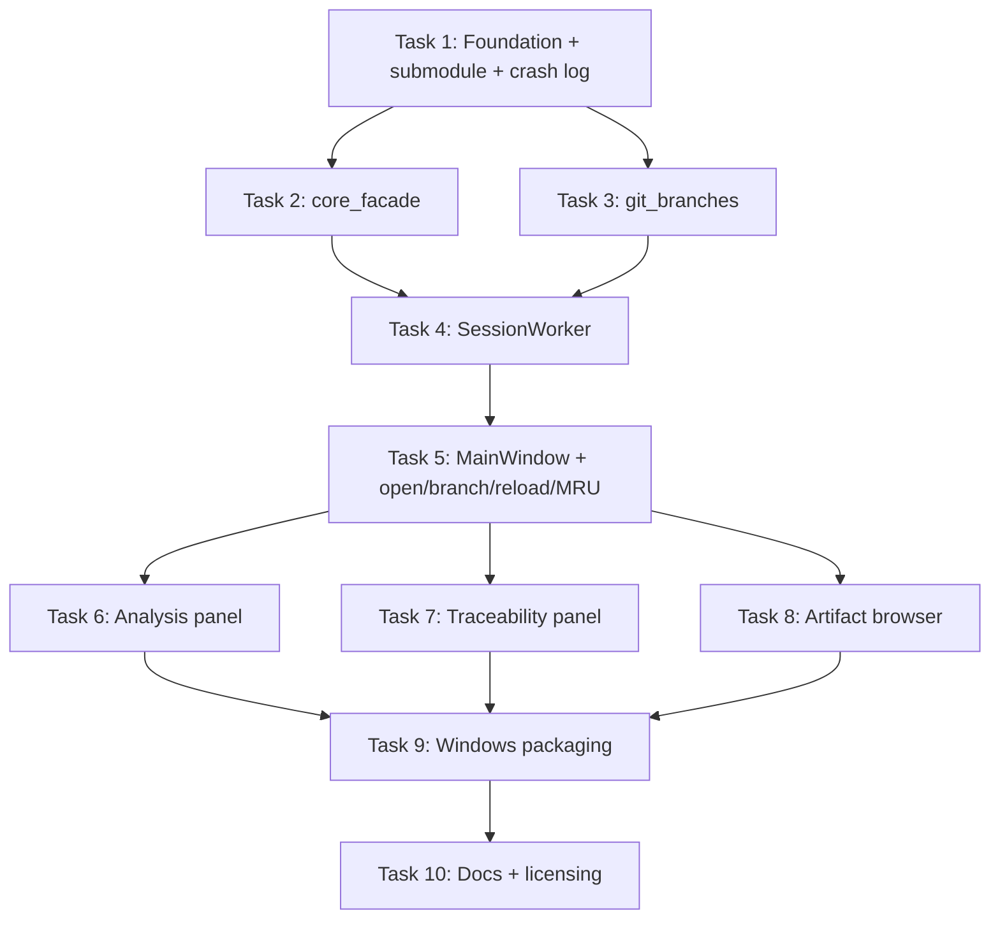

# Task Summary — Native Desktop App for Syntagmax (Reviewer, v1)

**Spec**: `docs/specs/native-desktop-app.spec.md`
**Critique applied**: `docs/critiques/native-desktop-app.critique.md`

This directory decomposes the full spec into ten standalone, independently testable tasks. Each `task-NN-*.md` carries its own objective, files, guidance, test requirements, and demo command.

## Dependency graph

## Parallelisation guidance

- **Wave 0 (serial, blocking everything)**: **Task 1**. It advances the submodule, creates `pyproject.toml`, the package skeleton, and the `sys.excepthook` crash logger. Nothing else can run until the submodule exposes `syntagmax.api` and `uv sync` works.
- **Wave 1 (parallel)**: **Task 2** (`core_facade`) and **Task 3** (`git_branches`) are independent of each other and both depend only on Task 1. Run them concurrently in separate sub-agents.
- **Wave 2 (serial)**: **Task 4** (`SessionWorker`) joins Tasks 2 and 3.
- **Wave 3 (serial)**: **Task 5** (`MainWindow`) depends on Task 4 and provides the shell the panels attach to.
- **Wave 4 (parallel)**: **Task 6** (Analysis), **Task 7** (Traceability), **Task 8** (Browser) are independent panels on the Task 5 shell. Run concurrently. They touch disjoint files (`analysis_panel.py`, `trace_panel.py`, `browser_panel.py` + `markdown_view.py`).
- **Wave 5 (serial)**: **Task 9** (packaging) needs all panels present to produce a meaningful build.
- **Wave 6 (serial)**: **Task 10** (docs) last.

## Shared conventions (apply to every task)

- British English, Oxford commas, no hard-wrapped Markdown prose.
- `uv` for all Python commands; `pwsh -NoProfile -NoLogo`.
- Package root `src/syntagmax_desktop/`; tests in `tests/`; `QT_QPA_PLATFORM=offscreen` for any test constructing a `QApplication`; `pytest-qt`'s `qtbot` for cross-thread signal assertions.
- No import of `syntagmax-gui`. Consume only `syntagmax.api`.
- All core calls go through `core_facade` → `SessionWorker`; the UI thread never calls `syntagmax.api` directly.
- Reuse a project under `syntagmax/example/` as the test fixture.

## Must-address critique items mapped to tasks

| Critique | Task |
|---|---|
| P1/X2 `allow_dirty_worktree=True` default | Task 2 |
| E1/X1 guarded non-destructive checkout, detached HEAD | Task 3 |
| E2/X3 orthogonal `direction` + `flat` | Tasks 2, 7 |
| E3 `pytest-qt` for signal tests | Tasks 1, 4 |
| E4 `sys.excepthook` crash log | Tasks 1, 9 |
| E9 submodule pin `cca2a29` on `more-gui-adaptations` + import sanity test | Task 1 |
| P2 clickable parent/child links | Task 8 |
| P3 severity filters | Task 6 |
| P4 reload (F5) + recent projects | Task 5 |
| E5 search debounce + busy-mask | Tasks 4, 8 |
| E6 virtual Qt models | Tasks 7, 8 |
| E7 `utf-8-sig` CSV + locked-file handling | Tasks 2, 7 |
| E8 `setBaseUrl` for Markdown images | Task 8 |
