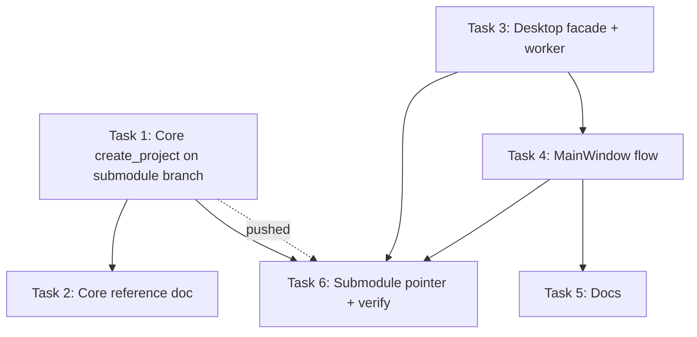

# Task Summary — Create a New Project from the Desktop App

**Spec**: `docs/specs/new-project.spec.md`
**Critique applied**: `docs/critiques/new-project.critique.md`
**Source**: GitHub issue #1 ("New Project").

This directory decomposes the full spec into six standalone, independently testable tasks. Each `task-NN-*.md` carries its own objective, files, guidance, test requirements, and demo command. This is the first write capability in Syntagmax Desktop (a bounded project bootstrap); the application remains a read-only reviewer after creation.

## Dependency graph

## Parallelisation guidance

- **Wave 0 (parallel start)**: **Task 1** (core, on the submodule branch) and **Task 3** (desktop facade + worker) can begin concurrently against the agreed `create_project(path) -> Path` signature. They touch disjoint repos/files. **Task 4** (main window) depends on Task 3's `created` signal and can follow immediately once the signal exists.
- **Docs in parallel**: **Task 2** (core reference) and **Task 5** (desktop README + reference) are independent and can be drafted alongside the code.
- **Wave 1 (join)**: **Task 6** is the integration gate. It requires Task 1 to be committed **and pushed** on `feat/api-create-project` (critique E8) before the superproject submodule pointer is advanced, and Tasks 3–4 complete, before the full suite can go green end-to-end.
- Hard ordering: **Task 1 (pushed) → Task 6**; everything else slots around it.

## Shared conventions (apply to every task)

- British English, Oxford commas; no hard-wrapped Markdown prose; relative paths only.
- `uv` for all Python commands; `pwsh -NoProfile -NoLogo` for shell.
- Desktop package root `src/syntagmax_desktop/`; tests in `tests/`; `QT_QPA_PLATFORM=offscreen` for any test building a `QApplication`; `qtbot` for cross-thread signal assertions.
- All core calls go through `core_facade` → `SessionWorker`; the UI thread never calls `syntagmax.api` directly. New Project writes run on the worker thread (R7).
- The core never commits and performs no `git init`; the scaffold writes files only.

## Must-address critique items mapped to tasks

| Critique | Task |
|---|---|
| P7/E2 dual-config refusal (`.syntagmax/config.toml` or flat `config.toml`) | Tasks 1, 4 |
| E1/X1 atomic scaffold with rollback | Task 1 |
| E5 reject filesystem root | Task 1 |
| P4 default `REQ/` directory | Task 1 |
| E3 UI-thread `iterdir()` guard | Task 4 |
| P6 `No` default on the non-empty warning | Task 4 |
| E4 busy lockout of New/Open/Reload | Task 4 |
| E9 MRU stores project root, not config path | Task 4 |
| P1/X2 first-run hint; P3 Reveal Project Folder | Task 4 (+ Task 5 docs) |
| E8 push submodule branch before pointer update | Tasks 1, 6 |
| E7 negative tests (permission, flat config, busy state) | Tasks 1, 3, 4 |

## Deferred (recorded in the spec's Decisions, not implemented)

- **P2** parent-folder + project-name dialog (kept `getExistingDirectory` with guiding title) — D5.
- **P5** optional "Initialise Git repository" checkbox (conflicts with the no-git-bootstrap decision) — D3.
- **P8** runtime success metrics (verified behaviourally by tests; no metrics backend ships) — D7.
